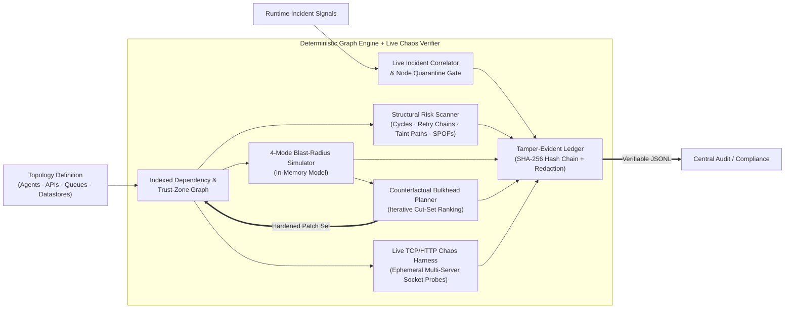
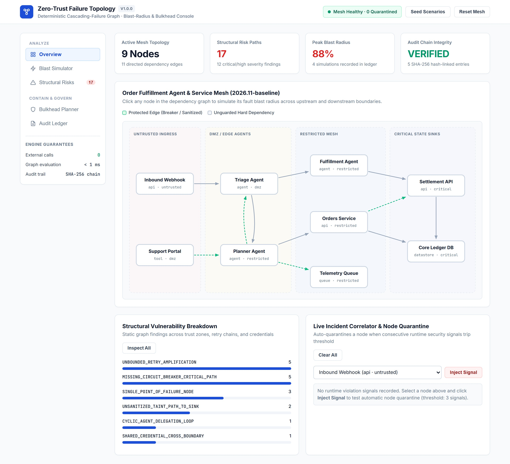
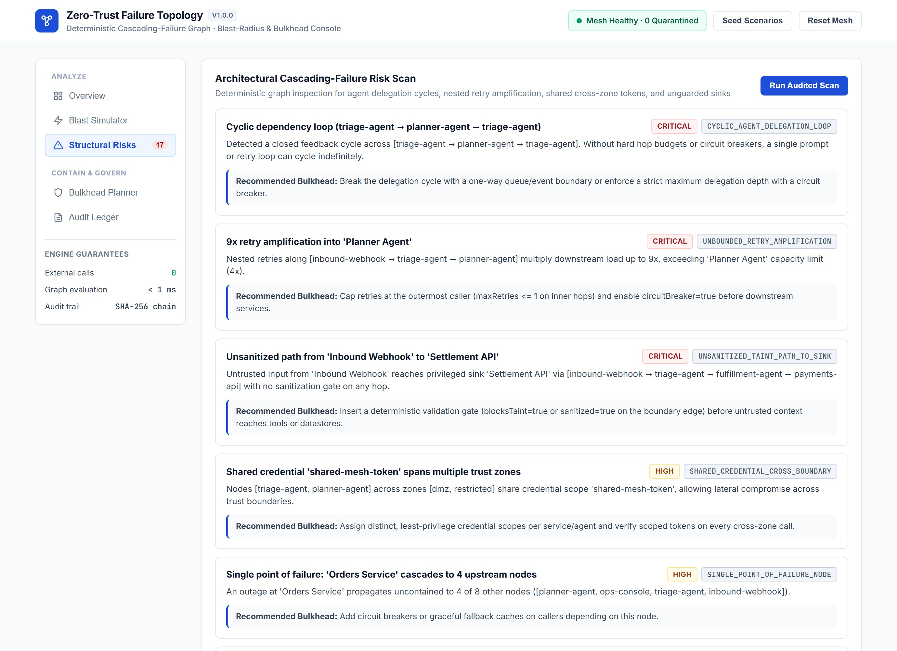
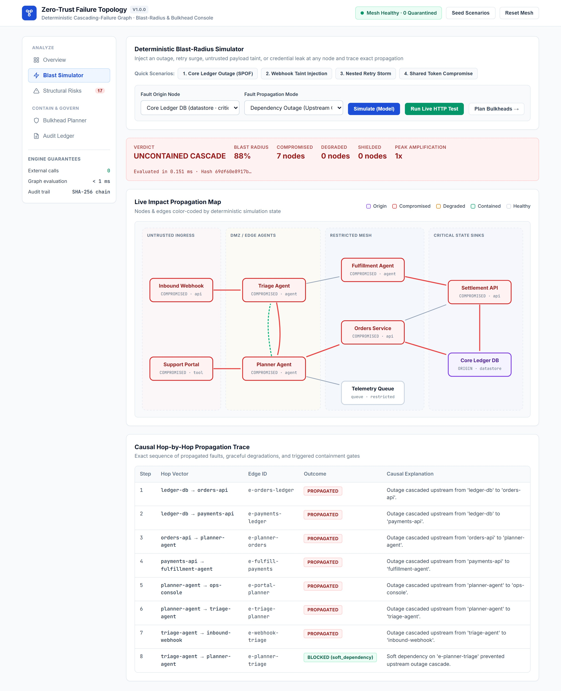
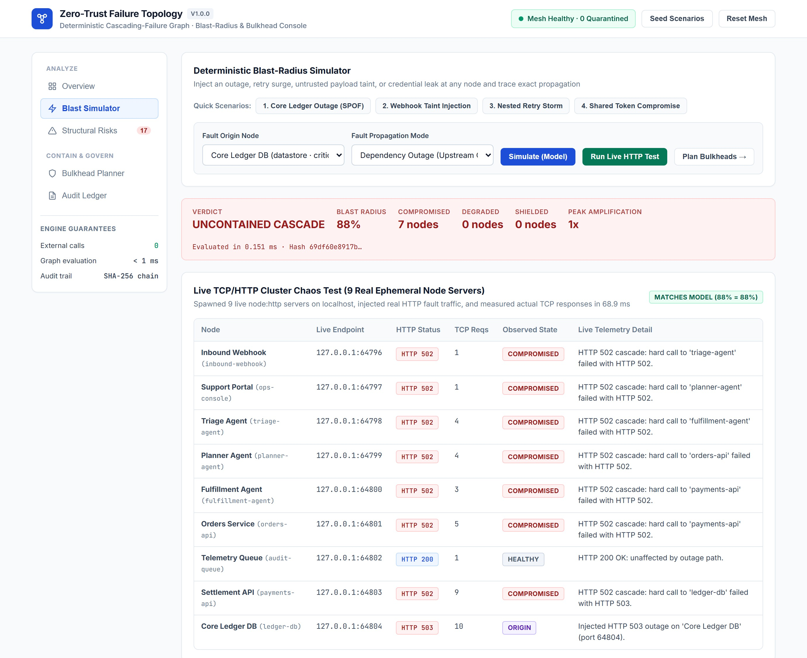
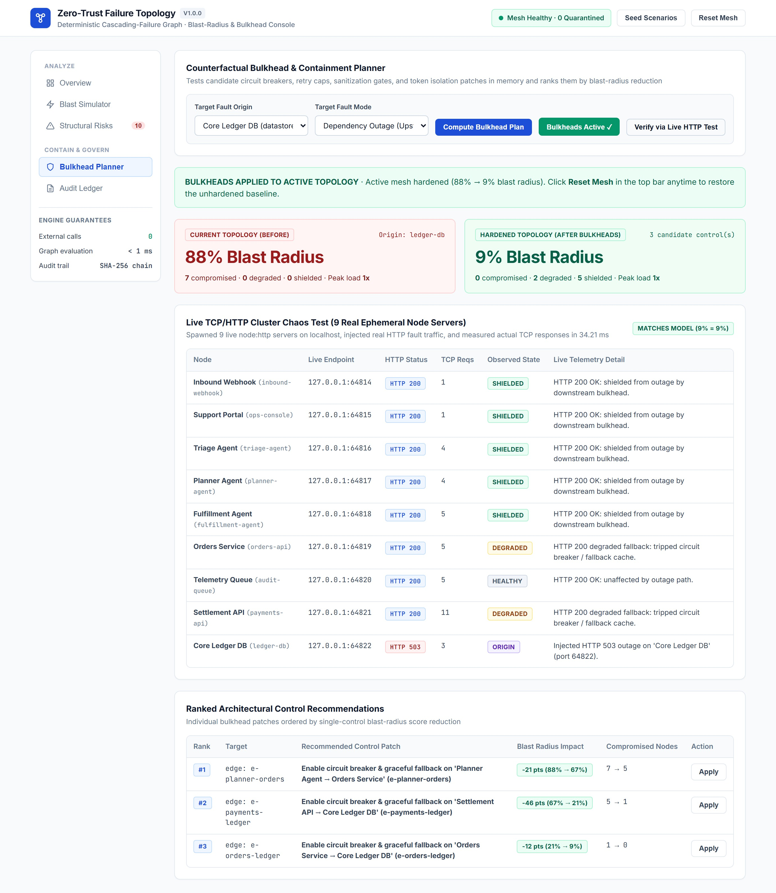
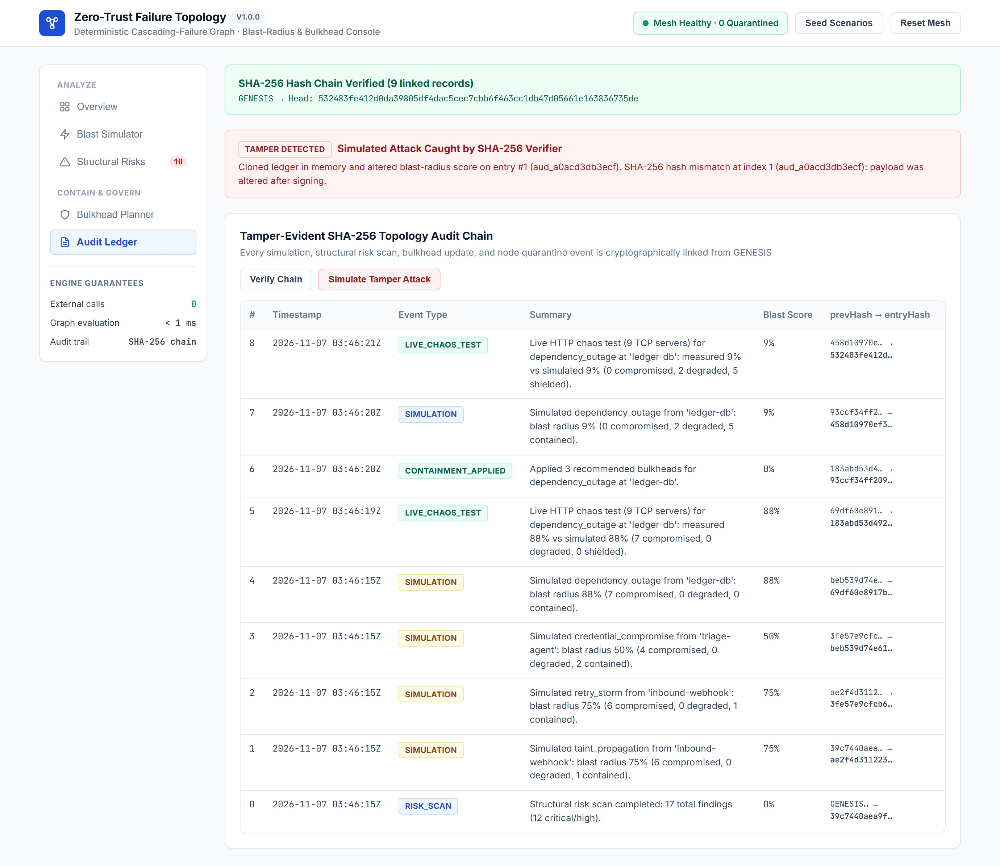

# Zero-Trust Failure Topology

[](https://github.com/abul-lab/Zero-Trust-Failure-Topology/actions/workflows/ci.yml)
[](LICENSE)
[](package.json)

**A deterministic blast-radius simulator, bulkhead planner, and live HTTP chaos verifier for multi-agent and service architectures.** Before a single slow database, retry loop, poisoned webhook, or leaked token brings down an entire agent mesh, this engine maps how every agent, tool, API, queue, and datastore connects across trust zones—detecting cascading-failure paths in memory (no network calls), ranking the bulkheads that contain the blast radius, verifying those controls over real localhost TCP/HTTP servers, and recording every result in a tamper-evident SHA-256 audit chain.

> **Model the cascade in memory, verify the bulkheads over live HTTP.**
> Individual prompt filters and tool guards inspect one request at a time, yet production incidents spread *between* components—through nested retries, shared credentials, cyclic agent handoffs, and hard dependencies lacking circuit breakers. Combining fast deterministic graph analysis with a live multi-server TCP/HTTP chaos harness proves both where a failure will spread and that the proposed boundary controls actually stop it over real sockets.

---

## Why

Teams connecting multiple AI agents, internal APIs, and datastores hit four recurring architectural failures:

| Gap | What It Costs |
| :--- | :--- |
| **Hidden single points of failure.** One downstream service stalls, and every upstream caller blocks waiting on hard dependencies with no fallback or circuit breaker. | A localized database slowdown cascades into a full multi-agent outage. |
| **Compounded retry storms.** An ingress webhook retries `2x`, an orchestrator agent retries `2x`, and a domain API retries `2x` (`3 × 3 × 3 = 27x` load). | Self-inflicted traffic spikes overwhelm healthy downstream services during transient blips. |
| **Lateral spread across trust zones.** Two agents in different zones share a credential scope, or untrusted webhook data flows through intermediaries into a critical sink without sanitization. | A single compromised edge component gains a path to privileged financial or state datastores. |
| **Unverified bulkhead assumptions.** Teams add ad-hoc timeouts on paper without testing whether parallel dependency paths still propagate `HTTP 502` / `503` failures across live endpoints. | Redundant fault paths remain open while engineering effort goes into low-impact controls. |

---

## What It Does

| Capability | How It Works |
| :--- | :--- |
| **Multi-Zone Dependency & Trust Graph** | Models `agent`, `tool`, `api`, `queue`, `datastore`, and `gate` nodes across `untrusted`, `dmz`, `restricted`, and `critical` zones with typed dependency, retry, sanitization, and token-verification attributes. |
| **Structural Risk Scanner** | Inspects the graph deterministically for agent delegation loops, compounded retry amplification chains, unsanitized paths to critical sinks, cross-zone shared credentials, unguarded hard calls, and single points of failure. |
| **4-Mode Blast-Radius Simulator** | Injects `dependency_outage`, `retry_storm`, `taint_propagation`, or `credential_compromise` at any node and computes deterministic blast-radius scores (`0%–100%`), load multipliers, and hop-by-hop causal traces in memory. |
| **Counterfactual Bulkhead Planner** | Tests candidate circuit breakers, retry caps, sanitization gates, and isolated identity scopes—including parallel cut-sets—and ranks the exact controls that collapse the blast radius (`Before` vs. `After`). |
| **Live TCP/HTTP Chaos Verifier** | Spawns an actual ephemeral `node:http` TCP server on localhost (`127.0.0.1:<port>`) for every node in the topology, fires real `fetch()` fault requests, retries, tainted payloads, and token scopes across OS sockets, and verifies measured HTTP outcomes against the graph model. |
| **Live Incident Quarantine Gate** | Correlates runtime violation signals per node and automatically quarantines unhealthy or misbehaving nodes once consecutive signals cross the configured threshold. |
| **Tamper-Evident SHA-256 Audit Chain** | Cryptographically links every simulation, live chaos run, risk scan, bulkhead patch, and quarantine event from `GENESIS` (`prevHash → entryHash`) with automatic secret redaction (`[REDACTED]`). |
| **Interactive Topology Console** | Built-in web UI with an interactive SVG dependency & impact map, one-click fault scenarios, live multi-server HTTP chaos tables, Before/After bulkhead planner, and live SHA-256 chain verification. |

---

## Architecture



---

## Interface Tour

<table>
  <tr>
    <td></td>
    <td></td>
  </tr>
  <tr>
    <td></td>
    <td></td>
  </tr>
  <tr>
    <td></td>
    <td></td>
  </tr>
</table>

---

## Graph Simulation vs. Live Multi-Server HTTP Verification

The engine pairs two complementary modes so architectural plans are never left as unverified theory:

1. **In-Memory Graph Simulation**: Evaluates dozens of candidate bulkhead combinations instantaneously to rank cut-sets and compute counterfactual `Before` vs. `After` blast-radius scores (`(compromised + 0.35 × degraded) / peerNodes`).
2. **Live TCP/HTTP Cluster Chaos Test (`POST /v1/chaos/live`)**: Spawns a real `node:http` server bound to an OS-assigned localhost port (`127.0.0.1:<port>`) for **every node** in the topology, executes real HTTP requests across TCP sockets with live retry loops, circuit breakers, payload taint gates, and token-scope checks, and compares measured HTTP status codes against the model prediction before tearing down the cluster.

### Measured 9-Server Live TCP/HTTP Results (Reference Mesh)

| Fault Mode (Origin) | Unhardened Mesh (Measured Live HTTP) | Hardened Mesh After Bulkheads (Measured Live HTTP) | Model vs. Live Match |
| :--- | :--- | :--- | :--- |
| **Dependency Outage** (`ledger-db`) | `ledger-db` returns `HTTP 503`; **7** upstream servers fail with `HTTP 502` (**88%** blast radius) | **0** peer `5xx` errors; `orders-api` & `payments-api` return `HTTP 200` degraded fallback (`2` degraded), **5** upstream servers return `HTTP 200` shielded (**9%** blast radius) | Exact (`88% → 9%`) |
| **Taint Propagation** (`inbound-webhook`) | Unsanitized HTTP `POST` flows over TCP into **6** servers including `payments-api` & `ledger-db` (**75%** blast radius) | `triage-agent` rejects tainted payload with **`HTTP 422`**; `payments-api` & `ledger-db` receive **`0` TCP requests** (**0%** blast radius) | Exact (`75% → 0%`) |
| **Retry Storm** (`inbound-webhook`) | Nested HTTP retry loops multiply live TCP requests across hops, tripping `HTTP 503` server overload | Circuit breakers open on first failure, halting retry amplification (**`0` overloaded servers**, **0%** blast radius) | Exact |
| **Credential Compromise** (`triage-agent`) | Shared `shared-mesh-token` + unverified edges get `HTTP 200` across **4** peer/downstream servers (**50%** blast radius) | Isolated identity scope + `scopedTokenVerified` reject lateral HTTP calls with **`HTTP 403 Forbidden`** (**0%** blast radius) | Exact (`50% → 0%`) |

---

## Built-In Detection & Simulation Coverage

| Category | Evaluated Graph Invariants | Findings & Modes |
| :--- | :--- | :--- |
| **Delegation & Control Loops** | 3-color depth-first cycle detection across agent handoff and service call edges | `CYCLIC_AGENT_DELEGATION_LOOP` |
| **Load & Retry Amplification** | Multiplicative retry compounding along unguarded upstream call paths vs. node capacity limits | `UNBOUNDED_RETRY_AMPLIFICATION`, `retry_storm` |
| **Cross-Zone Data Taint** | Unsanitized reachability from `untrusted` ingress nodes to `critical` or privileged state sinks | `UNSANITIZED_TAINT_PATH_TO_SINK`, `taint_propagation` |
| **Identity & Lateral Movement** | Ambient `credentialScope` reuse across distinct trust zones and missing per-caller scoped token checks | `SHARED_CREDENTIAL_CROSS_BOUNDARY`, `credential_compromise` |
| **Cascading Outage & SPOFs** | Transitive upstream hard-dependency reachability without circuit breakers or fallback degradation | `SINGLE_POINT_OF_FAILURE_NODE`, `MISSING_CIRCUIT_BREAKER_CRITICAL_PATH`, `dependency_outage` |

---

## Quick Start

**Docker:**

```bash
docker compose up --build -d
```

**Local Node.js (20+):**

```bash
npm install
npm run serve
```

Open **http://localhost:4200** for the Topology Console and HTTP API (`/healthz`, `/v1/topology`, `/v1/risks`, `/v1/simulate`, `/v1/containment/plan`, `/v1/chaos/live`, `/v1/audit/verify`).

---

## Honest Limits

1. **Declared Topology Accuracy**: Blast-radius scores and bulkhead plans are only as complete as the declared node and edge graph. Shadow HTTP calls, undeclared shared databases, or hidden background queues that are omitted from the topology definition cannot be analyzed until registered.
2. **Local Ephemeral HTTP Cluster vs. Distributed Production Infrastructure**: The built-in live chaos harness proves real HTTP status propagation, retry amplification, circuit-breaker shedding, taint rejection, and token-scope enforcement over local `node:http` TCP sockets—it does not replace full load testing against production cloud networks, TLS terminators, or database connection pools.
3. **Exporting Hardened Specifications to Production Gateways**: Applying bulkheads updates the topology specification (`circuitBreaker`, `maxRetries`, `sanitized`, `scopedTokenVerified`) and verifies them in the local HTTP cluster; production services still need those rules configured in their runtime gateway, service mesh, or inline action firewall.

---

## License

[MIT](LICENSE)
